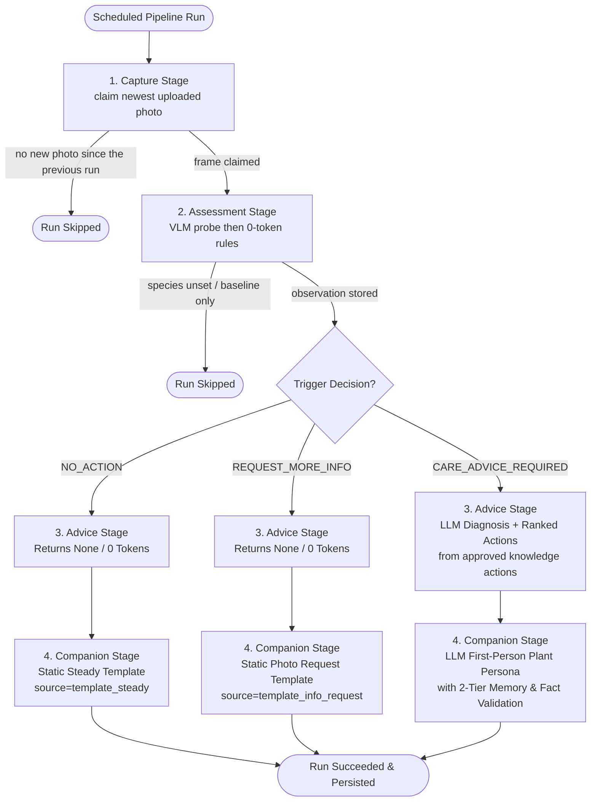

# Pet Plant Server — Post-Implementation Engineering Specification

**Document Version:** 1.0.0
**Status:** Aligned with the current server
**Date:** October 2026
**Audience:** Core Engineering, MLOps, Mobile / Client Integrations

---

## 1. System Overview

`pet-plant-server` is a modular monolith backend architecture for the Pet Plant autonomous monitoring platform. It connects upstream visual perception (VLM), deterministic botanical rule evaluation, LLM-driven diagnosis and care planning, first-person character dialogue projection, and client action tracking.

### Core Architectural Invariants

1. **Strict Context Isolation:** Each bounded context resides in its own isolated Python package under `src/<context>/` and owns an independent PostgreSQL schema (`auth`, `registry`, `vision`, `knowledge`, `orchestrator`, `action`, `assessment`, `advice`, `companion`).
2. **No Cross-Schema Foreign Keys:** Tables never declare cross-schema database foreign keys. Relationships across context boundaries are maintained via immutable `UUID` identifiers resolved via in-process published interfaces (`<context>.interface`).
3. **UUID identifiers & UTC TIMESTAMPTZ:** Table primary keys are native PostgreSQL `UUID` values generated by `uuid.uuid4()`, except `knowledge.species.species_code` (`TEXT`). All timestamps are timezone-aware `TIMESTAMPTZ` (`DateTime(timezone=True)`) normalized to UTC.
4. **Deterministic Gatekeeper:** The VLM probe (`mlops.assessment.run_probe`) runs first and writes the observation. The Event Engine that follows is 0-token, so a healthy/stable scan does not invoke the advice or companion LLMs.
5. **Approved probes, plus passages from the approved document:** The pipeline reads the approved probe set (`get_species_probes`) for checks and care steps. Approving a probe set stores that research document in `knowledge.knowledge_chunks`. Assessment and advice call `search_approved_passages` (keyword match plus cosine similarity). The VLM may use the passages to recognise a listed check. Advice may use them for the written assessment only. `get_care_knowledge` is not used by the pipeline.
6. **Continuous Pipeline Execution:** If assessment determines `NO_ACTION` or `REQUEST_MORE_INFORMATION`, `advice` returns `None` without raising `StageSkipped`, guaranteeing that the `companion` stage always runs and delivers user-facing dialogue.

---

## 2. PostgreSQL Schema & Data Model Specification

### 2.1 `auth` Schema
- **`auth.users`**:
  - `id`: `UUID` (PK, default `uuid.uuid4`)
  - `email`: `String(320)` (unique, not null, indexed)
  - `name`: `String(120)` (not null)
  - `hashed_password`: `String(255)` (not null)
  - `is_active`: `Boolean` (default True, not null)
  - `is_superuser`: `Boolean` (default False, not null)
  - `created_at`: `TIMESTAMPTZ` (default UTC now, not null)
  - `updated_at`: `TIMESTAMPTZ` (default UTC now, not null)
- **`auth.devices`** — one paired planter. Same-schema FK to `auth.users`:
  - `id`: `UUID` (PK, default `uuid.uuid4`)
  - `physical_id`: `String(128)` (unique, not null) — serial / MAC / provisioning id the device reports
  - `owner_id`: `UUID` (FK to `auth.users.id`, not null, indexed)
  - `name`: `String(120)` (nullable)
  - `status`: `String(16)` (not null, default `active`) — `active` | `revoked`
  - `token_hash`: `String(64)` (unique, nullable) — SHA-256 of the bearer token
  - `paired_at`: `TIMESTAMPTZ` (default UTC now, not null)
  - `revoked_at`: `TIMESTAMPTZ` (nullable)
  - `last_seen_at`: `TIMESTAMPTZ` (nullable)
  - `created_at`: `TIMESTAMPTZ` (default UTC now, not null)
- **`auth.device_pairings`** — one RFC 8628 pairing attempt:
  - `id`: `UUID` (PK, default `uuid.uuid4`)
  - `physical_id`: `String(128)` (not null, indexed)
  - `user_code`: `String(16)` (not null, indexed) — shown on the device, stored without the dash
  - `device_code_hash`: `String(64)` (unique, not null) — SHA-256 of the secret the device polls with
  - `status`: `String(16)` (not null, default `pending`) — `pending` | `approved` | `consumed` | `expired`
  - `expires_at`: `TIMESTAMPTZ` (not null)
  - `device_id`: `UUID` (FK to `auth.devices.id`, nullable)
  - `created_at`: `TIMESTAMPTZ` (default UTC now, not null)

Pairing HTTP: `POST /devices/pair`, `POST /devices/pair/approve`, `POST /devices/pair/token`. An owner lists and revokes devices on `/devices`.

### 2.2 `registry` Schema
- **`registry.plant`**:
  - `id`: `UUID` (PK, default `uuid.uuid4`)
  - `owner_id`: `UUID` (not null, indexed) — logical reference to `auth.users.id`
  - `name`: `Text` (not null). The HTTP API limits this to 1–120 characters
  - `species_code`: `Text` (nullable, indexed) — logical reference to `knowledge.species.species_code`
  - `species_confirmed_at`: `TIMESTAMPTZ` (nullable)
  - `device_id`: `Text` (nullable) — logical reference to `auth.devices.physical_id`. Partial unique index `uq_plant_live_device` allows one live plant per device
  - `note`: `Text` (nullable)
  - `created_at`: `TIMESTAMPTZ` (default UTC now, not null)
  - `updated_at`: `TIMESTAMPTZ` (default UTC now, not null)
  - `level`: `Integer` (not null, default 1)
  - `xp_ratio`: `Float` (not null, default 0.0)
  - `archived_at`: `TIMESTAMPTZ` (nullable)

**Plant registration:** `POST /registry/plants` (user JWT, `201`, response `PlantRead`).

| Field | Required | Notes |
|---|---|---|
| `name` | yes | 1–120 characters |
| `species_code` | no | Must exist in `knowledge.species` when set. Unknown code → `422` |
| `species_confirmed` | no | `true` sets `species_confirmed_at` |
| `device_id` | no | Must be a device paired to the plant's owner. Unknown → `422`. Already bound to another live plant → `409` |
| `note` | no | Up to 1000 characters |
| `owner_id` | no | Superuser only. Omitted means the caller |

Other routes: `GET /registry/plants`, `GET/PATCH /registry/plants/{plant_id}`, `DELETE /registry/plants/{plant_id}` (archives; `204`), `GET /registry/devices/me/plant` (device token), `GET /registry/devices/{device_id}/plant`.

### 2.3 `knowledge` Schema
- **`knowledge.species`**:
  - `species_code`: `Text` (PK) — for example `spath`
  - `scientific_name`: `Text` (not null)
  - `common_name`: `Text` (nullable)
- **`knowledge.research_document`** — append-only; one `active` row per species:
  - `id`: `UUID` (PK, default `uuid.uuid4`)
  - `species_code`: `Text` (FK to `knowledge.species.species_code`, not null)
  - `title`: `Text` (not null)
  - `body`: `Text` (not null)
  - `content_hash`: `Text` (not null) — SHA-256 of `body`
  - `author`: `Text` (not null)
  - `source_url`: `Text` (nullable)
  - `source_note`: `Text` (nullable)
  - `status`: `Text` (not null, default `active`) — `active` | `archived`
  - `created_at`: `TIMESTAMPTZ` (default UTC now, not null)
  - `archived_at`: `TIMESTAMPTZ` (nullable)
- **`knowledge.probe_set`** — one generation run. At most one `approved` set per species:
  - `id`: `UUID` (PK)
  - `research_document_id`: `UUID` (not null)
  - `species_code`: `Text` (not null) — composite FK with `research_document_id` to `research_document (id, species_code)`
  - `source_content_hash`: `Text` (not null)
  - `llm_model`: `Text` (not null)
  - `prompt_version`: `Text` (nullable)
  - `status`: `Text` (not null, default `draft`) — `draft` | `approved` | `archived`
  - `generated_at`: `TIMESTAMPTZ` (not null)
  - `approved_by`, `approved_at`, `rejected_by`, `rejected_at`, `archived_at`, `note`, `langfuse_trace_id`
- **`knowledge.probe`** — one yes/no check inside a set:
  - `id`: `UUID` (PK)
  - `probe_set_id`: `UUID` (FK to `probe_set.id`, not null)
  - `slug`: `Text` (not null, unique with `probe_set_id`)
  - `care_need`: `Text` (not null)
  - `priority`: `Integer` (not null)
  - `is_screening`: `Boolean` (not null, default false)
  - `question`, `worse_looks_like`, `better_looks_like`, `not_this`: `Text` (not null)
  - `evidence_quote`: `Text` (nullable)
- **`knowledge.probe_action`** — what to do when a probe fires:
  - `id`: `UUID` (PK)
  - `probe_id`: `UUID` (FK to `probe.id`, not null)
  - `ordering`: `Integer` (not null, default 0)
  - `instruction`: `Text` (not null)
  - `urgency`: `Text` (not null) — `today` | `this_week` | `this_month`
  - `expect_typical_hours`: `Integer` (not null)
  - `expect_max_hours`: `Integer` (not null)
  - `expected_signal`: `Text` (nullable)
- **`knowledge.probe_exemplar`** — few-shot image pointer (bytes live in the `exemplars` bucket):
  - `id`: `UUID` (PK)
  - `probe_id`: `UUID` (FK to `probe.id`, not null)
  - `role`: `Text` (not null)
  - `storage_key`: `Text` (unique, not null)
  - `content_type`: `Text` (nullable)
  - `label`: `JSONB` (nullable)
  - `origin`: `Text` (not null) — `own_capture` | `web`
  - `license`: `Text` (nullable)
  - `caption`: `Text` (nullable)
  - `created_at`: `TIMESTAMPTZ` (not null)
- **`knowledge.knowledge_chunks`**:
  - `id`: `UUID` (PK, default `uuid.uuid4`)
  - `species_code`: `Text` (not null, indexed)
  - `topic`: `Text` (not null)
  - `content`: `Text` (not null)
  - `metadata_json`: `JSONB` (not null, default `{}`)
  - `embedding`: `Vector(1536)` (nullable). OpenAI `text-embedding-3-small` is native. A shorter or longer Ollama vector is fitted to this width.
  - `research_document_id`: `UUID` (nullable FK to `research_document.id`)
  - `probe_set_id`: `UUID` (nullable FK to `probe_set.id`, indexed)
  - `source_content_hash`: `Text` (nullable)
  - `created_at`: `TIMESTAMPTZ` (default UTC now, not null)

### 2.4 `orchestrator` Schema
- **`orchestrator.pipeline_run`**:
  - `id`: `UUID` (PK, default `uuid.uuid4`)
  - `plant_id`: `UUID` (not null, indexed)
  - `scheduled_for`: `TIMESTAMPTZ` (not null, indexed)
  - `trigger`: `String(32)` (default "schedule", not null)
  - `status`: `String(32)` (default "queued", not null, indexed)
  - `current_stage`: `String(64)` (default "capture", not null)
  - `detail`: `Text` (nullable)
  - `created_at`: `TIMESTAMPTZ` (default UTC now, not null)
  - `started_at`: `TIMESTAMPTZ` (nullable)
  - `finished_at`: `TIMESTAMPTZ` (nullable)

### 2.5 `assessment` Schema
- **`assessment.observation`**:
  - `id`: `UUID` (PK, default `uuid.uuid4`)
  - `plant_id`: `UUID` (not null, indexed)
  - `run_id`: `UUID` (not null, indexed)
  - `timestamp`: `TIMESTAMPTZ` (not null)
  - `health_status`: `Text` (not null) — `healthy` | `possibly_unhealthy` | `unhealthy`
  - `confidence`: `Float` (not null)
  - `observations_json`: `JSONB` (not null, list of symptom records)
  - `consensus_json`: `JSONB` (nullable, multi-probe consensus results)
  - `image_refs_json`: `JSONB` (nullable, list of MinIO image keys)
  - `probe_set_id`: `UUID` (nullable) — logical reference to `knowledge.probe_set.id`. Null when the species had no approved set
  - `probe_results_json`: `JSONB` (nullable) — one entry per approved check asked
  - `description`: `Text` (nullable)
  - `companion_message`: `Text` (nullable) — dialogue backfilled by the companion stage
  - `created_at`: `TIMESTAMPTZ` (default UTC now, not null)
- **`assessment.trigger_result`**:
  - `id`: `UUID` (PK, default `uuid.uuid4`)
  - `run_id`: `UUID` (unique, not null, indexed)
  - `plant_id`: `UUID` (not null, indexed)
  - `decision`: `Text` (not null) — `NO_ACTION` | `REQUEST_MORE_INFORMATION` | `CARE_ADVICE_REQUIRED`
  - `primary_symptom`: `Text` (nullable)
  - `confidence`: `Float` (not null, default 1.0)
  - `reasoning`: `Text` (nullable)
  - `created_at`: `TIMESTAMPTZ` (default UTC now, not null)
- **`assessment.plant_milestone`**:
  - `id`: `UUID` (PK, default `uuid.uuid4`)
  - `plant_id`: `UUID` (not null, indexed)
  - `run_id`: `UUID` (nullable, indexed)
  - `timestamp`: `TIMESTAMPTZ` (not null)
  - `event_type`: `Text` (not null) — `first_symptom` | `health_crisis` | `severe_episode` | `near_death` | `full_recovery`
  - `description`: `Text` (not null)
  - `resolved_at`: `TIMESTAMPTZ` (nullable)
  - `created_at`: `TIMESTAMPTZ` (default UTC now, not null)

### 2.6 `advice` Schema
- **`advice.care_plan`**:
  - `id`: `UUID` (PK, default `uuid.uuid4`)
  - `care_plan_id`: `Text` (not null, indexed, not unique)
  - `plant_id`: `UUID` (not null, indexed)
  - `run_id`: `UUID` (not null, unique)
  - `status_label`: `Text` (not null)
  - `assessment`: `Text` (not null)
  - `confidence`: `Float` (not null)
  - `actions_json`: `JSONB` (nullable, deprecated expand-contract transition column)
  - `created_at`: `TIMESTAMPTZ` (default UTC now, not null)
- **`advice.care_plan_action`**:
  - `id`: `UUID` (PK, default `uuid.uuid4`)
  - `care_plan_pk`: `UUID` (FK to `advice.care_plan.id` ondelete `CASCADE`, not null, indexed)
  - `care_plan_id`: `Text` (not null, indexed)
  - `action_id`: `Text` (not null)
  - `priority`: `Integer` (not null, default 1, 1 = most urgent)
  - `action`: `Text` (not null)
  - `label`: `Text` (not null)
  - `action_type`: `Text` (not null, default `other`) — `water` | `move` | `inspect` | `other`
  - `approved_action_id`: `UUID` (nullable) — logical reference to `knowledge.probe_action.id`. Null only for the generic inspection step
  - `check_slug`: `Text` (nullable)
  - `urgency`: `Text` (nullable)
  - `expect_typical_hours`: `Integer` (nullable)
  - `expect_max_hours`: `Integer` (nullable)
  - `created_at`: `TIMESTAMPTZ` (default UTC now, not null)
- **`advice.diagnosis`**:
  - `id`: `UUID` (PK, default `uuid.uuid4`)
  - `plant_id`: `UUID` (not null, indexed)
  - `run_id`: `UUID` (nullable, indexed)
  - `diagnosis`: `Text` (not null)
  - `created_at`: `TIMESTAMPTZ` (default UTC now, not null)

### 2.7 `companion` Schema
- **`companion.messages`**:
  - `id`: `UUID` (PK, default `uuid.uuid4`)
  - `plant_id`: `UUID` (not null, indexed)
  - `run_id`: `UUID` (not null, indexed)
  - `decision`: `String(64)` (not null)
  - `message`: `Text` (not null)
  - `source`: `String(32)` (not null) — `llm` | `template_steady` | `template_info_request` | `template_fallback`
  - `created_at`: `TIMESTAMPTZ` (default UTC now, not null)

### 2.8 `action` Schema
- **`action.care_event`** — append-only. One row per button press. Rows are not updated or deleted:
  - `id`: `UUID` (PK, default `uuid.uuid4`)
  - `plant_id`: `UUID` (not null) — logical reference to `registry.plant.id`
  - `event_type`: `Text` (not null) — `action_completed` | `watered`
  - `care_plan_id`: `Text` (nullable, indexed)
  - `action_id`: `Text` (nullable)
  - `action_type`: `Text` (nullable) — `water` | `move` | `inspect` | `other`
  - `details`: `JSONB` (nullable)
  - `occurred_at`: `TIMESTAMPTZ` (not null) — client clock
  - `recorded_at`: `TIMESTAMPTZ` (default UTC now, not null)
  - `recorded_by_user_id`: `UUID` (nullable) — `auth.users.id`
  - `recorded_by_device_id`: `UUID` (nullable) — `auth.devices.id`. Exactly one of the two actor columns is set
  - `client_event_id`: `Text` (nullable). Partial unique index with `plant_id` when it is not null

### 2.9 `vision` Schema (owned by `capture`)
- **`vision.capture`** — one photo uploaded by a planter device (stored whether or not it passed quality; `run_id` set when a run claims it):
  - `id`: `UUID` (PK, default `uuid.uuid4`)
  - `plant_id`: `UUID` (not null, indexed with `captured_at`) — logical reference to `registry.plant.id`
  - `run_id`: `UUID` (nullable) — logical reference to `orchestrator.pipeline_run.id`; NULL for debug captures
  - `device_id`: `Text` (not null)
  - `captured_at`: `TIMESTAMPTZ` (not null)
  - `raw_object_key`: `Text` (not null) — key in the `captures` bucket
  - `width`, `height`: `Integer` (not null)
  - `brightness`, `blur_score`: `Float` (nullable)
  - `quality_passed`: `Boolean` (not null)
  - `quality_reason`: `Text` (nullable)
  - `created_at`: `TIMESTAMPTZ` (default UTC now, not null)
- **`vision.processed_frame`** — a grab that passed quality, preprocessed and aligned:
  - `id`: `UUID` (PK, default `uuid.uuid4`)
  - `capture_id`: `UUID` (FK → `vision.capture.id` ON DELETE CASCADE, not null)
  - `plant_id`: `UUID` (not null, indexed with `processed_at`)
  - `run_id`: `UUID` (nullable)
  - `object_key`: `Text` (not null) — key in the `frames-derived` bucket
  - `crop_type`: `Text` (nullable)
  - `width`, `height`: `Integer` (not null)
  - `aligned_to_frame_id`: `UUID` (nullable)
  - `processed_at`: `TIMESTAMPTZ` (not null)

---

## 3. Public Published Context Interfaces

```
                    ┌────────────────────────────┐
                    │    Orchestrator Stage      │
                    └─────────────┬──────────────┘
                                  │
         ┌────────────────────────┼────────────────────────┐
         ▼                        ▼                        ▼
┌──────────────────┐    ┌──────────────────┐    ┌──────────────────┐
│assessment.interf.│    │ advice.interface │    │companion.interf. │
└────────┬─────────┘    └────────┬─────────┘    └────────┬─────────┘
         │                       │                       │
         ├───────────────────────┤                       │
         ▼                       ▼                       ▼
┌──────────────────┐    ┌──────────────────┐    ┌──────────────────┐
│registry.interface│    │knowledge.interf. │    │  Action Tracking │
└──────────────────┘    └──────────────────┘    └──────────────────┘
```

### 3.1 `assessment.interface`
- `get_trigger_result(session: Session, run_id: UUID) -> TriggerResult | None`
- `get_recent_observations(session: Session, plant_id: UUID, n: int = 7) -> list[ObservationRead]` (Tier 1 Memory)
- `get_observation_by_run(session: Session, run_id: UUID) -> ObservationRead | None`
- `get_previous_observation(session: Session, plant_id: UUID, excluding_run_id: UUID | None = None) -> ObservationRead | None` — latest observation; `excluding_run_id` skips that run so companion does not treat the row just stored as the previous one
- `get_milestones(session: Session, plant_id: UUID) -> list[MilestoneRead]` (Tier 2 Episodic Memory)
- `update_companion_message(session: Session, run_id: UUID, message: str) -> None`
- `count_observations(session: Session, plant_id: UUID) -> int`

### 3.2 `advice.interface`
- `get_care_plan(session: Session, run_id: UUID) -> CarePlanRead | None`
- `get_latest_care_plan_for_plant(session: Session, plant_id: UUID) -> CarePlanRead | None`
- `get_care_plan_actions(session: Session, care_plan_id: str) -> list[CarePlanActionRead]`

### 3.3 `companion.interface`
- `get_latest_message(session: Session, plant_id: UUID) -> CompanionMessageRead | None`
- `get_message_by_run_id(session: Session, run_id: UUID) -> CompanionMessageRead | None`

### 3.4 `knowledge.interface`
- `get_species(session: Session, species_code: str) -> SpeciesRead | None` — catalogue row; `assessment.assess_frames` uses `scientific_name` (or the code if unregistered)
- `get_care_knowledge(session: Session, species_code: str, query_vector: list[float] | None = None, *, limit: int = 4, max_chars: int = 2500) -> str | None` — free botanical text (pgvector, falling back to the active research document). **Not used by the pipeline.**
- `search_approved_passages(session: Session, species_code: str, query_text: str) -> str` — hybrid search over passages stored when the probe set was approved. Assessment sends the result to the VLM as reference text. Advice uses it for the written assessment only. Empty when there is no approved set, embedding fails, or the database cannot run the search.
- `get_species_probes(session: Session, species_code: str) -> SpeciesProbesBundle | None` — approved probe bundle. Assessment asks its probes as VLM checks. Advice builds care steps from its actions.

### 3.5 `registry.interface`
- `get_plant(session: Session, plant_id: UUID) -> PlantRead | None`
- `get_plants(session: Session, plant_ids: list[UUID]) -> dict[UUID, PlantRead]`
- `get_plant_by_device(session: Session, device_id: str) -> PlantRead | None`
- `list_plant_ids(session: Session, owner_id: UUID | None = None, ...) -> list[UUID]`
- `is_plant_owned_by(session: Session, plant_id: UUID, user_id: UUID) -> bool`

### 3.6 `capture.interface`
- `get_frame_pair(session: Session, plant_id: UUID, run_id: UUID | None = None) -> FramePair | None` — with `run_id`, current = that run's processed frame and previous = the latest earlier one; without, the latest two. `None` when fewer than two frames exist
- `read_frame(frame: FrameRef) -> bytes` — JPEG bytes from MinIO (`CaptureDeviceError` if the read fails)

---

## 4. Pipeline Execution Logic & Invariants



### Pipeline invariants (capture & assessment)

- **Capture skip:** no photo captured since the previous run's frame (no upload, or only uploads that failed the quality gate) → `StageSkipped`. Planter devices upload with `POST /capture/devices/me/frames`; the quality check and crop run on upload, and a failed photo is still stored in `vision.capture` with its reasons.
- **Assessment calls VLM then rules:** `assess_frames` loads the approved probes and `search_approved_passages`, runs `mlops.assessment.run_probe`, and writes one observation. Each VLM JSON answer is checked against the observation JSON Schema before it can join the vote. `evaluate_observation` then applies the 0-token Event Engine.
- **Assessment skip:** `species_code` unset (`"species not set"`) or fewer than two processed frames (`"baseline frame stored; need two frames"`) → `StageSkipped`. Majority-invalid VLM output or unavailable Langfuse/VLM fails the run.

### Fact Preservation Validation
When `CARE_ADVICE_REQUIRED` invokes the Companion LLM:
1. Significant keywords are extracted from all care plan action strings (excluding common stop words).
2. The LLM response is checked for action coverage: each action must have at least 34% keyword coverage or at least 2 matching keywords.
3. If valid: persisted with `source="llm"`.
4. If invalid (dropped action): deterministic structured fallback template is generated and persisted with `source="template_fallback"`.

---

## 4.1 Multi-Provider LLM Architecture (Ollama & OpenAI)

The server runtime provides unified multi-provider LLM support via `mlops.factory.get_llm()`:
- **Local Self-Hosted (Ollama):** Configured via `LLM_PROVIDER=ollama`, `OLLAMA_HOST=http://localhost:11434`, and `OLLAMA_MODEL=llama3.2:latest` (or `qwen2.5:latest`) using `langchain-ollama.ChatOllama`.
- **Cloud API (OpenAI):** Configured via `LLM_PROVIDER=openai`, `LLM_MODEL=gpt-4o-mini`, and `LLM_API_KEY` using `langchain-openai.ChatOpenAI`.
- **Component Routing:** Both `mlops.advice` and `mlops.companion` seamlessly resolve their chat models through this factory, retaining structured output validation and fallback safety.
- **Passage embeddings** (`mlops.embeddings`) are separate from the chat model. `EMBEDDING_PROVIDER` is `openai` or `ollama`; blank follows `LLM_PROVIDER`. `openai` uses `LLM_API_BASE` and `LLM_API_KEY`. `ollama` uses `OLLAMA_HOST` and does not need an API key. `EMBEDDING_MODEL` defaults to `text-embedding-3-small`. Stored vectors stay 1536-dimensional: a shorter or longer Ollama vector is fitted to that width. The model name is recorded on each chunk in `metadata_json.embedding_model`.

## 4.2 VLM Provider Architecture (`local` | `vllm`)

`mlops.assessment.run_probe` fetches the Langfuse text prompt `assessment/plant_observation_pair` and calls `get_vlm_backend()`, selected by `VLM_PROVIDER`:

- **`vllm` (default):** OpenAI-compatible server at `VLM_API_BASE` (`VLLMBackend`). Production.
- **`local`:** in-process transformers from `VLM_LOCAL_MODEL_PATH` (`LocalTransformersBackend`; `uv sync --group vlm-local`). Development only; blocks the caller (including the orchestrator loop thread) for the duration of N inferences.

The prompt version's `config` supplies `runs`, `temperature`, `max_new_tokens` and `model`. A missing key raises `AssessmentUnavailableError`. There is no `VLM_MODEL` env var. The prompt is compiled with `probe_checks` and `retrieved_passages`. Passages come from `search_approved_passages` (species name plus the checks about to be asked) and are reference text for recognising a listed check. A search failure leaves them empty and the probe still runs. Each returned JSON object is validated with `RunObservation`'s JSON Schema, then as that model; one repair is attempted, and a run that stays invalid is dropped. The in-repo bootstrap text (`mlops.assessment.prompts.BOOTSTRAP_PROMPT`) is only what `python -m mlops.assessment.seed` registers as a new Langfuse version; the runtime never falls back to it. A production prompt that does not declare `retrieved_passages` still compiles.

## 4.3 Prompt Management (Langfuse)

`assessment`, `advice`, `companion` and `knowledge` resolve their prompts from Langfuse by the `production` label (experiments pin a version). New versions of the assessment, advice and companion prompts are registered with `python -m mlops.assessment.seed --model <id>`, `python -m mlops.advice.seed` and `python -m mlops.companion.seed`; a first version goes live, later ones are created unlabelled until promoted (`--promote`, or moving the label in the Langfuse UI). `advice` falls back to its in-repo bootstrap prompt when the `production` prompt cannot be fetched, and to its approved actions in order when the LLM call fails, so the companion stage always runs. Care plan steps come only from approved `knowledge` probe actions (the model picks and orders them by id; the instruction, urgency and expected time to effect are copied); a plant with no approved actions gets only a generic inspection step. When approved actions exist, `search_approved_passages` supplies passages from the approved document for the written assessment. Assessment searches the same passages earlier, for the VLM. A production prompt that does not declare `retrieved_passages` still compiles. `companion` likewise falls back to its bootstrap prompt, and to its deterministic template when the LLM call fails; the per-status tones live in the prompt version's `config.tones`.

---

## 5. Test layout

Counts are `def test_` functions in the tree. This table is not a recorded test run.

| Area | Files | Functions |
| :--- | :--- | ---: |
| Action API | `tests/action/test_action_api.py` | 8 |
| Advice service | `tests/advice/test_advice_service.py` | 6 |
| Assessment | `tests/assessment/` | 40 |
| Capture | `tests/capture/` | 43 |
| Companion | `tests/companion/`, `tests/api/test_companion_state.py` | 18 |
| Core (security, admin, storage, users, devices, VLM config) | `tests/core/` | 32 |
| Knowledge | `tests/knowledge/` | 48 |
| MLOps | `tests/mlops/` | 123 |
| Orchestrator | `tests/orchestrator/` | 25 |
| Registry | `tests/registry/` | 22 |
| **Total** | | **365** |
